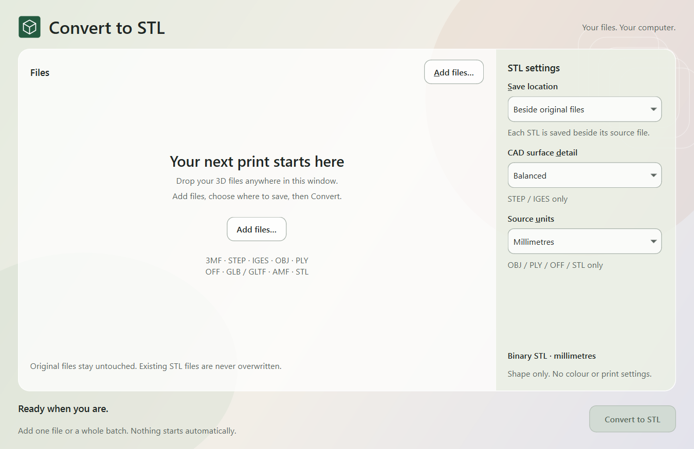

# Convert to STL

**A native Windows app that turns 3D models into STL files on your own computer.**

Add a file or a batch, choose where to save, and click **Convert**. No browser,
account, upload service, subscription, Python installation, or separate CAD app
is needed for the portable Windows release.

[Download for Windows x64](https://github.com/matt-bat/convert-to-stl/releases/latest)
· [User guide](docs/USER-GUIDE.md)
· [Formats and limitations](docs/FORMATS.md)
· [Build from source](docs/DEVELOPMENT.md)



## Get started

1. Download `convert-to-stl-v1.0.0-windows-x64.zip` from the release page.
2. Extract the whole ZIP to a writable folder.
3. Open `Convert to STL.exe` inside the `Convert to STL` folder. Keep `_internal`
   beside the executable; it contains the bundled runtime and CAD libraries.
4. Drop models into the window or choose **Add files**.
5. Review the settings, then click **Convert**.

Windows 10/11 x64 is the target. The release is unsigned and Windows may display
a publisher warning. There is no installer or administrator requirement. ARM64,
macOS, and Linux binaries are not provided. See [validation](VALIDATION.md) for
the scope of testing, and [troubleshooting](docs/USER-GUIDE.md#troubleshooting)
for startup or conversion problems.

## What it does

- Converts 3MF, STEP/STP, IGES/IGS, OBJ, PLY, OFF, GLB/GLTF, basic AMF, and STL.
- Saves one binary STL per source file, with assembled instances flattened into
  their positions. Output coordinates are millimetres.
- Shows only the settings relevant to pending files: CAD detail for STEP/IGES,
  source units for OBJ/PLY/OFF/STL, and output location for every format.
- Preserves original files and existing outputs, adding numbered filenames when
  necessary. Removing an item from the queue does not delete the source file.
- Runs conversions in separate processes, with Stop, readable errors, result
  dimensions, open-edge warnings, and retry controls.
- Uses a minimal, glass-inspired native interface with keyboard navigation and
  local scrolling at smaller window sizes.

**Adding files never starts conversion.** Files added during a running batch
wait for the next click of Convert. Requeue failed also waits for your click.

STL contains shape only, without colours, materials, textures, parametric CAD
history, or slicer settings. This app does not promise automatic mesh repair or
print readiness. Read the [format support table](docs/FORMATS.md) before using
specialist 3MF or AMF features. G-code and proprietary CAD project files are
not supported.

## Local operation

Conversion runs on your CPU. The application has no account system, telemetry,
automatic update check, or model-upload feature. GLTF remote dependencies are
rejected; local sidecar files must remain with their model. Source builds need
network access to obtain dependencies. See [privacy and data](docs/USER-GUIDE.md#privacy-and-data).

## Develop and test

Use Python 3.12 x64 on Windows, from the repository directory:

```powershell
py -3.12 -m venv .venv
.\.venv\Scripts\python.exe -m pip install -r requirements-lock.txt
.\.venv\Scripts\python.exe -m pytest -q
.\.venv\Scripts\python.exe app.py
```

To build and verify the complete portable release:

```powershell
.\build.ps1
```

The build checks source tests, frozen conversion workers, and the real packaged
GUI, then creates the portable ZIP, complete source ZIP, checksums, and release
manifest in `artifacts/releases/`. It stops when a required check fails.
[Development documentation](docs/DEVELOPMENT.md) explains the architecture,
commands, release process, and the dependency license bundle.

## Project information

- Author: Matt Bateman ([matt-bat](https://github.com/matt-bat))
- Current release: **1.0.0** — [changelog](CHANGELOG.md)
- [Contributing](CONTRIBUTING.md) · [Security](SECURITY.md) · [Validation](VALIDATION.md)

## License

The original project uses the **Convert to STL Attribution-Required
Non-Commercial License v1.0**, following the same terms as the author's other
projects. Attribution is required. Commercial use requires prior written
permission. See [LICENSE](LICENSE) for the full terms.

Third-party libraries are separately licensed; the project license does not
replace their terms. The portable download includes `THIRD-PARTY-NOTICES.txt`
and `licenses/`. See [third-party components](docs/THIRD-PARTY.md), including
the applicable LGPL replacement and debugging rights. The repository is
public and source-available; its noncommercial license is not an OSI-approved
open-source license.
